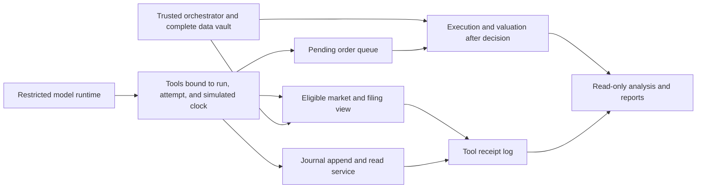

# Four-quarter benchmark and controlled information access

Status: the technical-only v9 environment with structured decision journals is implemented. See [the implementation guide](STUDY_ENVIRONMENT.md) for actual sandbox, tools, journal, qualification gates and commands. This document preserves the broader design, including the future optional filing track. NDX is the sole Nasdaq reference. The study year and its data archives are not yet selected/imported; the implemented annual launcher uses independent quarterly resets. Prior results/runs artifacts were cleared at user request on 2026-09-13; historical study qualification remains available.

## Experiment structure

Evaluate a completed calendar year as Q1 January–March, Q2 April–June, Q3 July–September, and Q4 October–December. Exchange sessions, holidays, early closes, and timestamps come from a versioned calendar. The target year and reset/carry policy are awaiting user selection.

Recommended default: four independent quarters. Each model/replicate starts each quarter with a fresh portfolio, empty journal, fresh runtime session, and identical funding and information budgets. Market and filing history before the quarter remains available within the registered history limits. Model-generated experience from other quarters, models, or replicates does not carry over.

Preserve the existing funding convention unless deliberately changed in the new profile: $500 initially, plus $500 before the first exchange session of each subsequent month. Thus each independent quarter has $1,500 contributed principal. This funding choice must be registered before inference.

If the user selects continuity, the four runs are resumable segments of one annual experiment: portfolio, journal, pending accounting obligations, and admissible memory carry forward. Segments must execute in chronological order and resume from authenticated prior state. Report quarter returns using the actual opening equity of each segment.

Independent quarterly results must not be called the realized return of a continuous annual account. Report quarterly outcomes and distributions. A geometrically linked reset-strategy illustration, if provided, must disclose the reset and reinvestment assumptions. Four quarters within one year are not four independent market regimes or sufficient evidence of general superiority.

Register one suite manifest and four immutable child profiles containing year, dates, universe and source identities, reference series, funding, execution, information policy, journal policy, tools, prompt, budgets, presentation order, models/runtimes, and replicate count. Predeclare independent repeats; replicate labels are not provider sampling seeds. The current exact-Muse/free-only qualification remains in force until additional routes are explicitly qualified under new profiles.

## Nasdaq-100 comparison

Use only the Nasdaq-100 price index (NDX) as the requested Nasdaq reference. Keep the existing cash and security-equal-weight controls as additional comparisons. Portfolio dividend accounting remains intact; report the dividend contribution separately and label NDX as a price index so the comparison is explicit.

Distinguish two calculations:

- Market movement: a labeled index return over explicitly stated start/end timestamps.
- Funded reference account: the same contributions as the model, converted to reference units at the same execution timestamps and valued at the same ending timestamp.

The reference importer must prove the required timestamp coverage, including contribution-session opens. Do not silently substitute previous closes for unavailable opens, mix sources opportunistically, or relabel a price-index return as total return. If only closes are obtainable, retain that series as a descriptive reference; a separately versioned close-execution track or a separately labeled, properly accounted ETF proxy would be needed for matched execution. Index units are a hypothetical reference account, not a claim that the index is directly tradable.

For each quarter/model/replicate, report final equity, principal, dollar profit, TWR, excess TWR in percentage points, drawdown, volatility, Sharpe with its risk-free convention, tracking error, information ratio, exposure, concentration, turnover, contribution deployment, trade attribution, fills/rejections, tool usage, failures, tokens, time, and cost. Show annualized statistics as descriptive estimates from short windows. Pair comparisons within the same quarter and information/execution contract. Show all attempts and uncompleted runs in operational reporting.

## Trusted simulated clock

The orchestrator owns time. Tool arguments, journal prose, filenames, runtime wall time, and report contents cannot change it.

Proposed daily convention for the new version:

1. Execution date D is a valid exchange session.
2. `decisionAt` is five minutes before that session's scheduled open, converted from the exchange timezone to an explicit UTC instant.
3. `marketObservedThrough` is the preceding exchange session's close. Daily market tools never return any bar from D, including its opening price.
4. Financial-background eligibility uses verified `availableAt < reportCutoff`, where `reportCutoff` is the calendar quarter's start at 00:00 in the registered exchange timezone. The same immutable filing snapshot is used for every decision throughout the quarter; newly published reports are not added mid-quarter. Daily market observations still advance each exchange session.
5. Append the final pretrade decision record and revoke write/tool capabilities before replaying queued orders at D's open.
6. Value at D's close. Publish fills and subsequent observations to the next decision only.

The exact clock convention is part of the new profile. UTC conversion must use an exchange calendar/timezone implementation with DST tests, not a fixed UTC offset. Every model in a comparison receives the same cutoff rules.

At the start of each daily decision session, the runner loads the next uncommitted exchange date from authoritative run state and creates an immutable server-side context:

```text
runId, modelId, replicateId, quarterId, attemptId
sessionDate, decisionAt, marketObservedThrough
reportSnapshotId, reportCutoff, priorJournalRoot
```

Every request is bound to this context through a short-lived capability. The model may see relevant clock metadata but cannot submit or overwrite these fields. All model turns and tools within the daily session share the context. A retry keeps the date, market/report views, and prior committed journal root, while receiving a new attempt ID. Time advances only after the orchestrator commits the day, never because a provider conversation ended or the real clock advanced.

`get_price(ticker)` means the latest observable price for this session, not its execution price. For a January 22 pre-open decision, it returns the previous exchange session's close with its true observation timestamp. It must not relabel that close as a January 22 trade price. Observing January 22's open and then filling at that same open would change the causal execution contract and is not part of this design.

## Architecture and trust boundary



The complete dataset, future files, cross-run results, and authoritative journal store belong to trusted services. The model-facing process receives a bounded historical view and scoped capabilities, not paths or handles into the complete vault. The per-session market/report tool service itself gets only the eligible snapshot, so it cannot return future rows even if an argument-validation check fails. The journal service gets only the current run's authorized history and append scope. A filesystem directory exists for human inspection, but the model cannot browse or edit it directly.

Use an explicit tool and environment allowlist. The runtime gets no shell, generic filesystem read/write, browser, arbitrary HTTP, external MCP connectors, delegation, or access to another model's session. Network access is limited to the qualified inference transport and the scoped tool service. Enforce filesystem/network isolation at the process boundary where supported; client permission configuration alone is a narrower guarantee. Fail qualification if the stronger declared isolation cannot be enforced, rather than silently claiming it.

Construct child environments from the minimal required keys instead of inheriting all of `process.env`. Keep provider credentials in the transport layer and out of model-visible errors, logs, and prompts. Tool URLs/capabilities expire when their attempt ends. Artifact rendering must escape journal/report text and never execute embedded HTML or follow document instructions.

### Concrete sandbox construction

Provision a qualified OCI runtime on a suitable host and launch a fresh container for every daily decision attempt. Pin the image digest, official client version, installed dependencies, and sandbox-policy version. Mount a read-only runtime/configuration image plus a small private writable scratch volume. Do not mount the repository, home directory, host credentials, complete market archive, journal store, other runs, or a container-management socket.

Run as an unprivileged UID, drop Linux capabilities, enable no-new-privileges and compatible seccomp/AppArmor policies, and set process, memory, CPU, disk, and wall-time limits. Use isolated process/mount/network namespaces, no host networking, and no published inbound ports. These are explicit isolation mechanisms, not defaults assumed from the word container. See [Docker's security architecture](https://docs.docker.com/engine/security/) and [seccomp documentation](https://docs.docker.com/engine/security/seccomp/).

The network policy is deny-by-default with access only to the session's tool broker and a fixed inference gateway. The gateway forwards only the qualified official model transport to registered upstream endpoints; it is not an arbitrary URL/CONNECT proxy. It must preserve the real official client's provider requirements and pass the existing identity/pricing/runtime audits. Prefer gateway-held provider credentials where compatible; any credential required inside the official client is narrowly scoped, injected only into that transport, and absent from model-visible tools and logs. No arbitrary DNS, internet, host-local services, metadata endpoints, or other sandbox endpoints are reachable.

The independent broker validates request scope and cutoff even for callers on the sandbox network. Orders and journal appends remain outside the model process. Revoke capabilities before execution so late callbacks cannot modify accepted state. Kill the complete process group/container on timeout and discard scratch state afterward. Containers share a host kernel; a stronger threat model covering a compromised runtime needs additional isolation, such as a separately qualified hardened runtime or VM.

Qualification actively attempts forbidden filesystem reads/writes, outbound connections, cross-session broker requests, and late journal writes, and verifies denial. A runtime that cannot enforce the declared policy cannot launch a scored run; there is no unsandboxed fallback.

Host inspection on 2026-09-12: Docker, Podman, and bubblewrap were not found on PATH. `unshare --user --map-root-user --net /bin/true` failed when writing `/proc/self/uid_map` with `Operation not permitted`. This establishes that the tested unprivileged namespace path is unavailable here; it does not establish that every administrator-provisioned isolation mechanism is impossible. Provisioning and qualification remain required. The installed OpenCode client's permission layer is not this OS sandbox.

## Tool contract

All tools use strict schemas that reject unknown fields, malformed dates, nonfinite values, out-of-universe identifiers, and oversized ranges. The service binds experiment, quarter, model, replicate, attempt, and cutoff; callers cannot override these. Broker entry checks and response validation supplement the prefiltered data view.

| Tool | Permitted inputs and result |
|---|---|
| `get_universe()` | Current registered eligible security set and only permitted contemporaneous metadata. |
| `get_price(ticker)` | Latest observable close and its actual timestamp, selected entirely from session context. No date/as-of argument and no live quote fallback. |
| `get_ohlcv(ticker, lookback?)` | Bounded historical bars ending at the session market cutoff. Lookback is a bounded positive integer; callers cannot supply dates or change the endpoint. |
| `get_indicators(ticker?)` | Indicators calculated exclusively from eligible bar prefixes. Include calculation version and observation cutoff. |
| `list_filings(ticker, forms?, limit?, cursor?)` | Only eligible filing metadata. Pagination and counts operate after temporal filtering. |
| `read_filing(filingId, section?, cursor?)` | Content from an eligible, pinned filing version. Guessing an ID must not bypass listing or visibility checks. No caller-provided URL/path. |
| `get_financial_facts(ticker, concepts, lookbackPeriods?)` | Historical facts with units, period, accession, and availability provenance from the frozen quarter snapshot. No caller-controlled cutoff or current/latest aggregate passthrough. |
| `get_portfolio()` | Frozen pretrade cash/holdings with observable valuations, plus eligible scheduled contributions/actions. No queued fill updates. |
| `buy(...)`, `sell(...)` | Append orders to the current attempt; acknowledge queued intent without any D-open-derived feedback. |
| `journal_append(text, evidenceIds?, requestId)` | Append to the current simulated date and current attempt only. Date/path/run selection is not an argument. |
| `journal_read(date, cursor?, limit?)` | Own authorized prior committed dates and current attempt entries. No future, foreign run, or foreign attempt data. |
| `journal_search(query, through?, cursor?, limit?)` | Search only the same eligible journal view, with bounded results. |

Read tools return a receipt identifier, information cutoff, relevant source/version, and data. Trusted audit records retain validated arguments, authorization outcome, result hash, and server-assigned scope/timestamps. Avoid exposing complete-corpus manifests or future-dependent metadata in model responses. Errors for unavailable document IDs must not distinguish a future document from a nonexistent document.

Invalid/refused calls consume the registered operational budget and remain audit evidence. Attempts to add `date`, `asOf`, `end`, or other unsupported fields to price tools fail schema validation rather than being silently ignored. Requests that would cross any date boundary return no forbidden payload. Journal reads, searches, and writes count toward the declared budget; total output, per-call size, journal-entry size, and entries per day also have registered caps. New journal/filing tools require explicit budget and protocol versions, never silent addition to v7.

## Financial reports and price provenance

The primary experiment focuses on technical analysis and portfolio strategy. Raw historical OHLCV, optional derived indicators, portfolio tools, and the journal are sufficient for this track. Financial background is an optional, separately registered information track; unrestricted news is not a dependency for launching the technical track.

If financial background is enabled, use archived original SEC EDGAR 10-K/10-Q filings, relevant 8-K earnings exhibits, and appropriate 20-F/6-K filings for foreign issuers. Use stable security-to-issuer mappings and accession identities. Optional issuer investor-relations releases require equally strong original-publication and version evidence. A source download/import process runs outside the agent sandbox; model tools serve only frozen local extracts and source receipts.

For an April-June run, freeze documents established as public before April 1. A January-March financial report first published in May is excluded for the entire April-June run and can enter the July-September snapshot if its availability is established before July 1. Therefore "reports through March" means documents already public by the end of March, not every financial statement describing a period ending in March. Quarter-end does not imply report-publication date. The same rule applies at January 1, July 1, and October 1.

This intentionally keeps financial context static within a quarter while prices evolve daily. It measures technical strategy with optional historical background, not response to newly released quarterly earnings. Do not select records using fiscal-quarter names: companies' fiscal calendars differ. Use publication/availability timestamps and separately report the periods covered.

There is no general-news tool in the initial technical track. If added later, a news track needs a named historical archive, frozen original article versions, documented publication/availability timestamps, and the same quarter cutoff. Modern search results, updated articles, and retrospective summaries are not admissible substitutes. Source choice and historical coverage must be qualified before enabling that track.

Maintain separate fields for the period a record describes, original publication/acceptance time, validated public availability, dataset ingestion time, accession/source identity, and revision identity. A December period-end report published in February is unavailable in January. A later amendment or restated comparative value does not replace what an earlier decision could have read.

SEC APIs aggregate data across submissions; the frames API selects the last-filed fact fitting a requested period. Therefore fetching a historical period from today's API is not itself a point-in-time guarantee. Resolve facts to specific eligible filings and preserve units, fiscal periods, contexts, and revisions. See [SEC EDGAR API documentation](https://www.sec.gov/search-filings/edgar-application-programming-interfaces).

Acceptance time is not proven public availability. The SEC describes variable dissemination lag and explicitly states that its header has no timestamp for first availability on sec.gov. Preserve timestamp-source/timezone evidence. For the strict track, missing or ambiguous availability evidence excludes that document until eligibility can be established. An independently versioned delayed-availability approximation may use a declared conservative lag, but must not claim that an assumed delay proves historical availability. See [SEC timestamp and availability guidance](https://www.sec.gov/about/webmaster-frequently-asked-questions).

Do not let unrestricted web search, latest fundamentals, current analyst consensus, or third-party summaries enter model tools. A forecast published before the cutoff can be valid evidence even when it refers to a future period; label it as a forecast, not a subsequently realized result. Retrieved filing text is untrusted evidence and cannot change tool policy.

Market-data checks must cover revisions, adjustment policy, splits, dividends, stale bars, missing opens, and historical security identity. Serving a past date from a newly downloaded adjusted series does not by itself establish what was available then. Preserve source snapshots; use raw execution prices and only causally eligible corporate actions for observations/indicators. Document any reconstructed history that lacks original contemporaneous snapshots as a remaining limitation.

Establish Nasdaq membership using evidence available at the quarter start, not today's members. Use a fixed start-of-quarter universe for the initial standalone-quarter design and disclose tracking differences from the evolving official index. Do not silently remove a security at the start because it later disappears, lacks a price, or has an unsupported action. Define event handling before inference; unresolved events stop/quarantine the affected experiment with visible coverage diagnostics rather than selecting a surviving basket. Corporate-action support must account for carried holdings faithfully.

## Append-only reasoning journal

Human-facing layout (year/date shown only as an example):

```text
results/runs/<model>/<replicate>/<quarter-run>/
  journal/
    2025-01-22.txt
    2025-01-23.txt
  journal-events.jsonl
  attempts/<attempt-id>/...
```

The append-only event ledger is authoritative; daily text files are a readable rendering. Each acknowledged append is durable and receives a server-generated ID, sequence, simulated date/cutoff, attempt scope, real audit timestamp, evidence references, and integrity link. Text never gets to define authoritative metadata. An entry's bytes cannot be changed after acknowledgment, including during the same day. Later corrections are new entries with references to the original.

`journal_append` automatically selects today's date, for example January 22. It cannot write January 21 or January 23. Date files accept additions only while that simulated day/attempt is authorized; they become sealed when the day is committed. Existing entries are never truncated, replaced, renamed, or deleted through model tools.

The journal date is the immutable `sessionDate` set by the runner at the start of the daily decision, not a date parsed from the prompt/journal text and not the host's current date. A phrase such as "today is January 23" in model output has no authority. Reads may select an earlier journal date, but the service checks it against the same run and session boundary. The full permitted past journal is available through bounded read/search tools; it is not restricted to five days and is not dumped wholesale into every prompt.

Record a concise decision memo covering action/no-action, evidence receipt references, investment thesis, chosen size/cash rationale, relevant risks, invalidation conditions, and changes from earlier theses. A pretrade final entry is required on every completed day, including holds, and is linked to the actual queued order batch. Corrections or order changes before finalization require a new final entry. After finalization the broker closes; execution happens only afterward.

The journal records the model's stated rationale. It is not proof of its hidden internal reasoning or of causal explanations for performance. Do not require disclosure of private chain-of-thought. Evaluate factual support and behavior against these decision memos and authoritative tool/order records.

Retries need explicit semantics:

- Preserve failed-attempt entries unchanged in the evaluator's audit view; mark them with an additional terminal-status event, not an edit.
- Retry from the same committed portfolio and the same predecision journal root. Failed-attempt journal text is not injected into retry memory under the proposed default.
- Own current-attempt entries are readable immediately after acknowledgment. Committed prior-date entries remain readable within the registered budget.
- Seal the successful attempt's final journal root and order batch in the daily commit. Crash recovery cannot accidentally promote failed entries, execute orders twice, or repeat deposits/actions.
- Bind idempotency keys to run/date/attempt and payload. A repeated key with the same payload returns the original receipt; a conflicting payload is rejected. Serialize concurrent appends and finalize operations.
- Revoke an attempt before execution begins. Execution-validation failures return no opening-price details to a retried decision; quarantine failures when the predecision information boundary cannot be preserved.

Filesystem permissions, a dedicated service identity, and no direct agent mount enforce immutability relative to the model. Hash chains plus daily commits detect altered order/content, while independent retained roots/backups are required to detect wholesale replacement by a privileged host actor. Hashes alone are not write protection.

## Behavior analysis

Predeclare behavior measures before reading the new results: universe research coverage, evidence support, thesis persistence and revisions, response to invalidation, entry/exit timing, winner/loser holding periods, concentration, cash deployment, contribution response, turnover, rejected future-data requests, and journal compliance. Link findings to original dates, receipt IDs, and actual actions. Do not infer behavior from prose alone or mechanically penalize every justified change of thesis.

Use descriptive comparisons across all four quarters and replicates. Separate exploratory patterns from preregistered tests and avoid treating days within a run as independent samples. A secondary model-assisted journal review must run in a separate evaluator environment, have no write access to the experiment, and support its judgments with citations; deterministic facts come from the ledger.

Journaling changes the agent's memory and can change its trading. The journal-enabled protocol is a new cohort. Technical-only and technical-plus-filings experiments must also be separate cohorts with matched information and budgets per model. A later journal/no-journal comparison can measure the effect of memory, but must not relabel the existing Muse run.

Tool isolation cannot remove historical information already learned during model pretraining. Prospective runs and separately labeled anonymization experiments remain necessary checks on historical-memory contamination.

## Freedom to choose a strategy

Define the objective, available information, long-only/no-leverage constraints, contribution schedule, execution rules, and budgets identically for every model. Do not prescribe securities, indicator thresholds, market screens, daily trading, target cash allocation, number of holdings, stop-loss levels, or an order for calling tools. Buy, sell, hold, concentrated, diversified, and all-cash decisions remain permitted.

Journal requirements standardize evidence and accountability rather than prescribe a trading method. Record each model's chosen rationale and horizon; different strategies are valid. Risk and return metrics remain separate, without a hidden reward favoring one style. Historical performance reports and evaluator judgments are not fed back into the active model session.

Tool selection still shapes the task. Offering SMA20/SMA50/RSI14 alone makes those indicators salient. Preserve raw OHLCV access for every eligible security and model-chosen bounded history depth; additional indicator options must be deterministic, derived from permitted history, and available equally. Avoid model-specific prompts and preselected candidate stocks. Register security presentation order and use separate order-variation experiments to check positional bias.

Price accuracy requires data validation in addition to isolation: confirm symbol/issuer identity, observation timestamps, OHLC consistency, session completeness, currencies, and corporate-action reconciliation. Cross-check a predeclared sample against an independent source, particularly splits and large moves; unresolved discrepancies fail qualification instead of being silently patched. Every price/indicator response identifies its true observation date and source/calculation provenance. Access controls enforce which validated data can be read; they do not guarantee that a vendor supplied an error-free price.

## Acceptance tests and rollout

The key property is that changing inaccessible future data cannot change the visible past. With a fixed recorded request sequence and the same eligible history, mutate future prices, reports, restatements, journal entries, and other runs. Model-visible results, errors, search order, counts, and pagination must remain identical; private full-dataset integrity metadata may differ. This is a deterministic tool-boundary test, not an assertion that two stochastic model reruns produce identical answers.

Required adversarial coverage:

- Injected date/as-of/end fields into date-free price tools, forged session context, negative/huge limits, guessed future filing IDs, malformed timestamps, weekends, DST, and early closes.
- A daily session advancing the market date while retaining its quarter report snapshot; a March-period report published in May remaining inaccessible throughout Q2 and becoming eligible only for the registered Q3 snapshot.
- A valid old reporting period first disclosed after cutoff; later restatements; date-only/ambiguous availability; cached future results requested at an earlier date; future-dependent search/ranking/statistics.
- Indicator calculation with injected future bars, backward adjustment from future corporate actions, and future-price leakage through order estimates, rejections, or portfolio values.
- Prior/future-date journal writes; forged scope; cross-model/quarter/replicate reads; path traversal, symlinks, raw filesystem/network tools, and instructions embedded in reports or journal text.
- Append/finalize races; duplicated requests; failed attempts; provider timeouts; late tool calls; crash after journal acknowledgment; crash before/after daily commit; corrupted/deleted ledger entries.
- All live adapters expose exactly the registered tools and use equivalent cutoffs; wrong model/runtime/pricing and incomplete reference data fail preflight.

Implementation order:

1. Select year/reset policy and freeze funding, reference alignment, information timing, journal limits, and model/replicate matrix in a new suite profile.
2. Implement the scoped clock/data broker, strict tool schemas, response checks, and independent isolation qualification with synthetic hostile fixtures.
3. Implement durable journal append/read/search, finalization, retries, and replay validation; integrate a new prompt/tool protocol without changing old artifacts.
4. Import and qualify historical membership, market/actions, and Nasdaq references. Add the filing track only when availability/revision provenance satisfies its declared contract.
5. Extend quarterly performance and evidence-linked behavior reports. Complete deterministic quarterly runs and adversarial/offline verification.
6. Qualify each permitted model/runtime, perform a separately labeled smoke, then run the registered quarterly replicate matrix and preserve all outcomes.

## Existing implementation inspected

- `src/run/day.ts:55` builds the market context with `market.asOfBefore(ticker, date)` and computes indicators from that historical prefix.
- `src/agent/tools.ts` currently exposes only portfolio, universe, OHLCV, indicators, buy, and sell. Tools rely on the filtered working state; there are no filing or journal tools yet. The current OHLCV schema permits an unrestricted numeric lookback, which should become a bounded integer in the new schema.
- `src/opencode/mcp.ts` validates tool arguments and counts attempts; its per-decision endpoint receives the filtered state.
- `src/opencode/config.ts` denies other client tools and isolates runtime configuration. `src/opencode/agent.ts` still inherits the parent environment and does not itself establish an OS filesystem/network sandbox.
- `src/agent/prompt.ts` currently embeds portfolio figures and recent rationales in the daily prompt. To satisfy the requested tools-only financial-data contract, the new prompt should contain clock, task, and policy metadata; prices, portfolio figures, and financial records should arrive through logged tool responses. Journal history should arrive through the scoped journal tools.
- Existing daily records preserve rationale and orders, but are not a model-maintained append-only journal. The new design needs explicit durability, scope, and recovery logic.

The design was originally reviewed without implementation. Current runtime verification and remaining data prerequisites are recorded in the linked implementation guide. The “Existing implementation inspected” section above describes the pre-v8 baseline.
